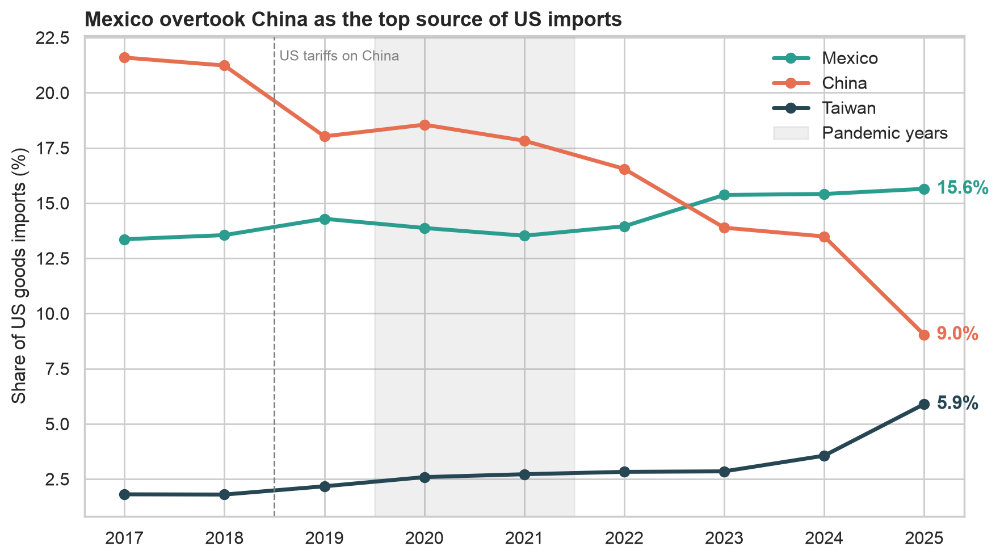
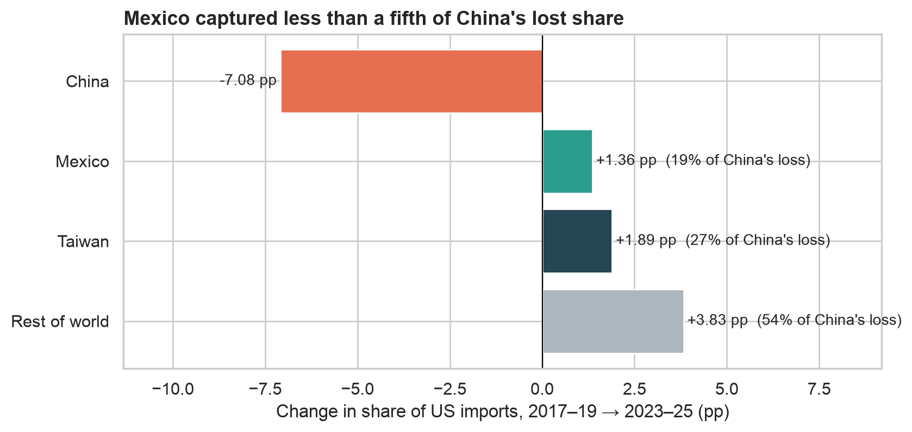
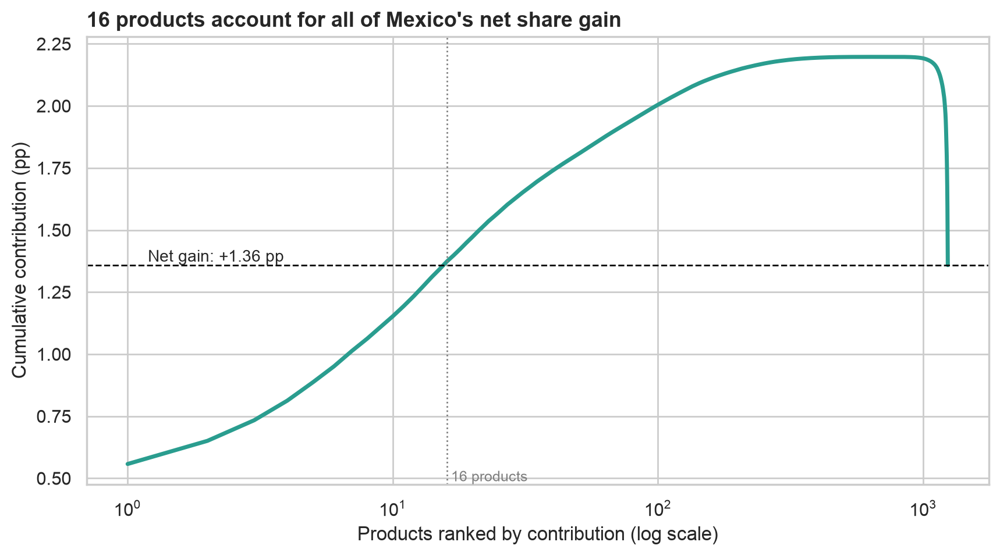
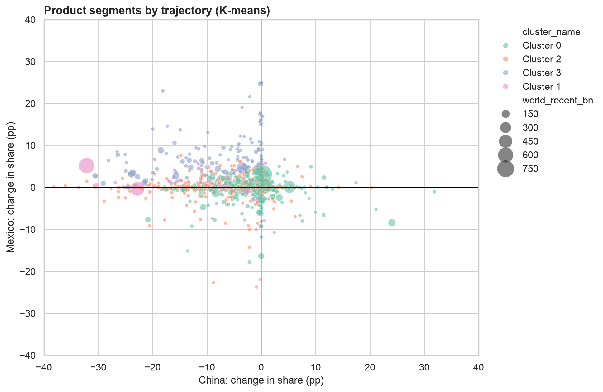

# Nearshoring: Real or Re-routed?

**Project report – IS507E Programming for Data Analytics, Rennes School of Business**
Axel Hernández Sanchez Navarro · Jorge Paulin · November 2026

## 1. Why the problem matters

Nearshoring is one of the most repeated investment theses about Mexico. As Mexican students, we hear it constantly in
financial circles: US–China tensions are pushing companies to relocate production to Mexico, so Mexican manufacturing,
logistics and industrial real estate are the opportunity of the decade. The headline evidence is real: in 2023 Mexico
overtook China as the largest source of US goods imports.

But a headline crossing can come from very different forces: genuine relocation, China shrinking while many countries
fill the gap, growth in sectors Mexico already dominated, or Chinese goods routed through Mexico. Each implies a
different opportunity, and overstating it can mean misallocated capital and misguided policy. This project tests the
narrative with data.

## 2. Data and approach

We built an end-to-end pipeline on the US Census Bureau International Trade API: monthly US imports for about 1,238
products (HS4 codes) from Mexico, China, Taiwan and the world, 2017–2025, around 463,000 raw records. After cleaning,
the data was stored as CSV and in a SQLite database. We compare a **baseline period (2017–19)** with a **recent period
(2023–25)**, using each partner's **share of US imports** (which removes inflation and market growth) and a
value-weighted **contribution** metric so that large products count more than small ones.
Full details: [`methodology.md`](methodology.md).

## 3. Findings

### Context: Mexico overtook China mainly because China fell

China lost **8.2 percentage points** of US imports between the two periods. Mexico captured **+1.74 pp (21%)**,
Taiwan **+2.22 pp (27%)** and the rest of the world **+4.24 pp (52%)**. Between 2017 and 2022 Mexico's share was
almost flat (13.4% → 14.0%); the 2023 crossing came from China's fall.

### H1 – Concentration: supported

**18 products out of 1,238** explain all of Mexico's net gain, and computers (HS 8471) alone explain **40%**.
About 89% of the gain is share genuinely won inside products; only 11% comes from Mexico's products growing faster
than average. Mexico's apparent losses are mostly shrinking categories (TVs, crude oil), where Mexico often gained share.

### H2 – Substitution of China: partially supported

The value-weighted correlation between China's and Mexico's share changes is only **−0.28**, against **−0.68** for
Taiwan. A weighted regression shows that for every 1 pp China loses in a product, **Mexico gains 0.09 pp**, Taiwan
0.36 pp and the rest of the world 0.55 pp. The result holds within sectors (−0.11). Substitution is clear in computers,
but China's large losses in phones and lighting went entirely to other countries, and in batteries China *gained* 25 pp
while Mexico lost 9 pp. How much of Mexico's gain counts as "substitution" depends on assumptions (25–74%), because
Mexico already supplied 28% of US computer imports before the trade war.

### H3 – "China+1", not Mexico-specific: supported

China's losses spread across many suppliers. In machinery, Taiwan captured almost twice Mexico's gain; in electronics
and textiles, other countries took almost all of it. Mexico's auto gains came at the expense of Japan, Korea and Europe,
not China. 14 of Mexico's top-50 gaining products are also among Taiwan's: the two grow together in the same
electronics supply chain.

### Models

- **K-means (K = 5)** separated "China retreat" products (China −18 pp, Mexico barely moves) from "Mexico's own wins"
  (Mexico +9 pp, China barely involved). Mexico's strongest gains and China's biggest losses are mostly different products.
- **Linear regression vs Random Forest:** both fail to predict Mexico's share change on unseen products (R² below zero),
  even when weighted by value. The drivers are firm-level investment decisions that trade data does not contain, and
  the more flexible model does not rescue a weak signal.

### Robustness: does it depend on 2025?

| | With 2025 (2023–25) | Without 2025 (2022–24) |
|---|---|---|
| Mexico's share change | +1.74 pp | +1.16 pp |
| Mexico's share of China's loss | 21% | 21% |
| Computers' share of Mexico's gain | 40% | 15% |
| Mexico's coefficient vs China | −0.09 | −0.07 |

Mexico's gain and its fifth of China's loss hold without 2025: the base is structural. The 2025 surge is mostly
computers, driven by the AI-server boom.

## 4. Conclusion

**Nearshoring in Mexico is real, but narrower than the narrative, and partly cyclical.** Mexico is one beneficiary
of China's decline, steadily taking about a fifth of it, not the main one. Its gains are concentrated in a few products,
and less than half of them move with China's losses; the rest reflect Mexico's own competitiveness.

## 5. What this means for the nearshoring investment thesis

| | Evidence |
|---|---|
| **Is the opportunity real?** | Yes, but narrow: about a fifth of China's lost share, stable with and without 2025. Not a broad wave. |
| **Where Mexico is winning** | Computers and servers (the largest, but tied to the AI cycle and Taiwanese supply chains); electrical equipment (transformers, switchboards, cables); medical instruments; heaters, forklifts and containers. |
| **Where Mexico is not winning** | Phones and lighting (China's losses went elsewhere), textiles, and batteries for electric vehicles (China gained). |
| **What is not new** | Autos: mostly NAFTA-era integration that predates the trade war. |
| **What the data cannot say** | Returns, factory investment (FDI) or industrial real estate demand. Trade flows are one signal among several. |

*This is an academic analysis of trade data, not investment advice.*

## 6. Limitations

- Trade data shows where goods ship from, not where value is added: a server "from Mexico" may contain mostly Asian components.
- Re-routing of Chinese goods through Mexico (H4) cannot be tested with this data.
- Imports are not investment: nearshoring is ultimately about factories, which this data does not cover.
- 2025 was an unusual year (tariff escalation, AI boom), so recent results are tested with and without it.
- All results are associations, not causal estimates.

## 7. Team roles

| Member | Role |
|---|---|
| Axel Hernández Sanchez Navarro | Data engineering: ETL pipeline (extraction, cleaning, loading) and the project code |
| Jorge Paulin | Data analysis: interpretation of results against the hypotheses, and chart design |

Details in [`TEAM.md`](../TEAM.md).
